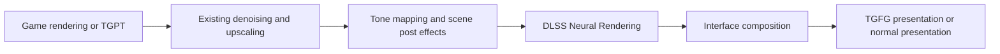

# TG Neural Rendering - high-level DLSS 5 specification

Status: researched design, updated 2026-10-07 with public-NGX and player-supplied-runtime findings. A beta SDK is not
a mandatory build dependency. Normal NGX loading of NR is a candidate, not a measured success; caller workarounds
are not license-cleared. Evidence and limits: [DLSS5-RESEARCH.md](DLSS5-RESEARCH.md). Working name:
**TG Neural Rendering**, GUID `com.wessberg.tgneuralrendering`.

## Implementation and pipeline update, 2026-10-07 evening

R17, 2026-10-09 supersession: the owner explicitly approved a separate compatibility adapter, including its
caller-name requirement, for community runtimes. The owner then rejected per-file allowlisting. The signed SDK
route stays the default; an unsigned/modified NR DLL automatically selects the NR-only adapter, which validates
its direct interface and runtime support. No player switch, driver replacement or changed trust policy for other
consumers. Details and hardware-evidence limits: [DLSS5-COMPATIBILITY.md](DLSS5-COMPATIBILITY.md).
The earlier caller-policy restrictions below describe the original research state and are superseded for this
NR-only route. The proprietary runtime remains outside packages.

The original research requirements below are retained. Ordinary public NGX has since created/evaluated NR on
our shared device, including offline RR coexistence. Both game versions compile; Mono is deployed. Current
evidence and remaining acceptance work: [DLSS5-TUNING.md](DLSS5-TUNING.md).

The owner's later instruction supersedes the original post-tone-map placement: both Before and After Upscaling
must precede motion blur, DoF, chromatic aberration and vignette. The implementation brackets SR/RR before
lens effects, using our HDR-to-LDR adapter on both routes; game tone mapping follows NR. HDR restoration uses
the original pixel's shoulder factor to apply NR's colour gain, avoiding near-white amplification (NR-17).
The neutral transform is reversible; changed model colour is not inverted through its own new peak. That adapter
is a measured integration choice, not NVIDIA's demonstrated tone-mapped input, and appearance/HDR validation
remains necessary. FG capture and UI follow NR. RR forces After; no noisy undenoised PT input is accepted.

### Renderer ownership: fog and geometry guides

Owner, 2026-10-07: "Keep in mind that the PT mod fundamentally renders the scene differently, including its own
rendering of fog". NR consumes the active renderer's completed scene, including its fog and transparents. With
PT enabled these are PT's responsibility; NR must not assume HDRP supplied them, add fog again, or split the
tracer's surface and volume lighting. Placement selects the side of SR/RR, while both choices precede lens
effects. RR still requires After because it denoises and upscales together.

Depth and motion come from the actual selected DLSS invocation. In 1.2.3 the bridge owns the NGX D3D11
observer formerly private to FG. FG and NR subscribe independently. The packet includes the actual resources,
image regions, vector scale, jitter, reset and depth convention. BU publishes its selected D3D11 RR inputs
at the shared-device handoff and only marks success after writing the upscaled output. NR associates that
packet with the gameplay camera's colour resource; missing, failed or mismatched calls disable NR, without
substituting another camera's guides. Before evaluates before SR; After evaluates after successful SR/RR.
The managed render-graph pass only supplies camera identity, settings and resource lifetime dependencies.

NR-10 / PT-72 remains a renderer migration requirement: when PT changes the visible geometry, the inputs to
DLSS itself must match it. Changing lighting or fog alone does not imply different surface motion. NR must
consume whatever DLSS actually uses, not invent a separate NR-to-PT lookup. PT's published guide API does
not yet export its own geometry depth/motion. Validate hair, glass/water and fog after PT updates that common
handoff. Current scene comparisons use PT Off; the real RR+NR GPU check is synthetic, not PT image acceptance.

## Goal

Add optional NVIDIA DLSS 5 Neural Rendering to Tainted Grail: The Fall of Avalon using TG Graphics Bridge. Players
install one TG mod, supply the NR DLL if required, enable a Video setting, and get the enhanced scene with unchanged
interface text. The owner expressly accepts supplying that DLL. RenoDX and
ReShade are not dependencies. The owner wants an independent NVIDIA SDK integration, with control over inputs,
placement and tuning. This is a separate visual enhancement; it does not replace Better Upscaling, Frame Generation
or Path Tracing, and must never be described as physically traced lighting.

## What the investigation confirms

| Question | Finding and evidence |
| --- | --- |
| Is direct NGX integration represented in NVIDIA code? | Yes. NVIDIA's [renderer adapter](https://github.com/nvpro-samples/vk_gltf_renderer/blob/master/src/dlss.cpp) probes, creates, evaluates and releases a separate NR feature through NGX. It supplies color, depth, motion, a control mask and reset information. This is Vulkan sample code, not a D3D12 implementation. |
| Does the sample require a special SDK? | Yes. Its [build configuration](https://github.com/nvpro-samples/vk_gltf_renderer/blob/master/CMakeLists.txt) checks for `nvsdk_ngx_helpers_dlssnr_vk.h`. It includes a local override example for `NVIDIA-NGX-DLSS-SDK-INTERNAL-v310.9.0-beta3`; this is an example path, not a public download or a required version. |
| Is that package publicly available through the reviewed download routes? | No public NR development-package download was established. The [DLSS release page](https://github.com/NVIDIA/DLSS/releases/tag/v310.9.1) still identifies 310.9.1 as latest. The [developer page](https://developer.nvidia.com/rtx/dlss) lists the conventional DLSS packages. The local 310.9.1 and Streamline 2.14.1 packages contain no NR helper header/runtime found by the targeted search. |
| Does a Streamline feature identifier suffice? | No. The local 2.14.1 header declares `kFeatureDLSS_NR = 1004`, but that does not supply a matching implementation or integration contract. [Public header](https://github.com/NVIDIA-RTX/Streamline/blob/v2.14.1/include/sl_core_types.h) |
| Is NR independent of SR, RR and FG? | NVIDIA describes it as an optional feature usable alongside those features, with game color and motion as inputs. Its currently announced launch hardware is RTX 50. Our availability decisions must still come from the authorized runtime. [NVIDIA announcement](https://www.nvidia.com/en-us/geforce/news/dlss-5-3d-guided-neural-rendering/) |
| Where does NVIDIA's example run it? | After tone mapping, before subsequent interface work, on a display-range image. The [renderer call site](https://github.com/nvpro-samples/vk_gltf_renderer/blob/master/src/renderer.cpp) excludes diagnostic/bypassed-tone-mapper paths. The [adapter declaration](https://github.com/nvpro-samples/vk_gltf_renderer/blob/master/src/dlss.hpp) documents LDR input and a clean denoised image. |
| Must we reuse RenoDX? | An independent implementation using authorized NVIDIA interfaces contains no RenoDX code and needs no RenoDX port license. No rights to its separate NR binary were established; this design does not use it. [RenoDX public-source license](https://github.com/clshortfuse/renodx/blob/main/LICENSE) |

Sources above were inspected on 2026-10-07. Moving-branch links are observations, not pinned build dependencies.
The follow-up [research](DLSS5-RESEARCH.md) establishes an additional route: build against the public SDK's generic
NGX API and load a player-supplied NR model. Community examples establish independent adapters but also contain
caller compatibility measures. They do not prove success through the ordinary NVIDIA loader. Record exact SDK
version, source revision, runtime hashes and applicable terms for each supported profile.

## Access and release requirements

The redistribution grant and its conditions are recorded in [the research](DLSS5-RESEARCH.md#licensing-findings-and-limits).
Do not treat contacting NVIDIA for a special redistribution exception as mandatory for standard licensed SDK use.
The exact NR runtime's terms and any caller workaround are separate questions. BYO delivery removes our model
redistribution; it is not a blanket grant for the player's acquisition/use or for bypassing runtime restrictions.

Research decisions and implementation acceptance conditions:

| Material/decision | Research outcome | Implementation condition |
| --- | --- | --- |
| Build SDK | Public NGX, including its D3D12 feature API; no mandatory beta helper. | Pin the public SDK and link its public interface. |
| Model delivery | Owner accepts player-supplied `nvngx_dlssnr.dll`; no official public NR package established. | Omit model from our release; validate the supplied file and fail gracefully when absent. |
| Backend route | Normal NGX driver-core dispatch first, shared device/session. | Distinguish discovery, creation and actual evaluation; success on our device remains unmeasured. |
| NR-specific interface | Community mapping exists; NVIDIA sample corroborates input concepts. It is unofficial. | Isolate a versioned adapter and verify accepted resources/settings with that runtime. No arbitrary private-vtable offsets. |
| Caller compatibility | Reviewed examples use naming/import workarounds; permission not established. | No silent fallback to those measures or another game's identity. A refusal is a recorded failure. |
| Packaging rights | Standard SDK grant exists with conditions; NR-specific bundling grant not established. | Ship our integration with applicable SDK terms/notices; BYO model mode remains the default delivery. |
| Beta access | No public download/admission policy established. | Optional future supported backend; not a prerequisite for compiling the public adapter. |

The implementation agent is not assigned another SDK-access or licensing survey. Implement the stated public-API
candidate and measure it. If the supplied runtime refuses normal loading, report the exact stage/result; a public
source example containing a bypass is not permission to adopt it. No successful runtime call is claimed by this spec.

## Player-supplied runtime

Use `BepInEx/TGNeuralRendering/Native/DLSS/nvngx_dlssnr.dll` as the defined placement. Also discover an existing
game-folder NR DLL without replacing it. Prefer the mod-folder file when both exist, report the selection, and keep
the existing compatible DLSS set intact. Register the selected folder before the shared NGX session starts.

Validate x64 format, NVIDIA signature and version/hash using the bridge's existing trust policy. A valid signature
establishes file identity, not permission or compatible hardware. Patched community runtimes may fail that policy;
accepting BYO did not authorize weakening it. Take hardware availability from actual runtime results.

The mod does not bundle, patch, rehost or automatically download the model, extract it from another game, rename
the game executable, or require a ReShade add-on. Existing community download URLs are evidence of availability,
not an authorized dependency feed. A future authorized redistribution grant can replace BYO packaging separately.

When missing, show an amber alert on the Neural Rendering row with one precise instruction, for example:
"The Neural Rendering DLL is missing. Put your nvngx_dlssnr.dll in BepInEx/TGNeuralRendering/Native/DLSS and restart."
Explain an unsupported or rejected file separately from a missing file. Do not route players through a settings
wizard or hand them motion-vector, NGX or HDR troubleshooting chores. Installing the mod without the DLL must leave
Better Upscaling, Frame Generation, Path Tracing and normal rendering usable.

## Architecture

Target both game versions: Mono/BepInEx 5 and normal/BepInEx 6, on the existing D3D11 game renderer. TGPT combinations
apply to Mono only. Build a managed plugin and a native bridge extension using the existing bootstrap/election
layout in [AUTOLOAD-INTEGRATION.md](AUTOLOAD-INTEGRATION.md). The extension asks for `NeedD3D12`; Frame Generation
continues to own presentation when installed. Do not create another D3D12 device or another swapchain owner.

The bridge already supplies the devices, signed vendor-DLL loading and D3D11/D3D12 sharing. Its extension interface
is a lifecycle interface, not a shared post-processing scheduler. The implementation must provide explicit ordering
for the NR render event and color handoff. Independent custom-pass registration order is insufficient.

NGX initialization and DLL discovery must be coordinated with TGFG and TGBU. TGFG's current search-path addition is
conditional on TGBU plus TGPT; it does not register a new NR folder. Establish the selected NR paths before the
first NGX initialization on the shared device. Keep per-feature handles separate, serialize access as the SDK
requires, and never shut down another mod's active NGX session when disabling NR. Resolve compatible DLL versions
as a documented set; preserve TGBU's settled rule for existing game-folder DLSS sets.

Useful implementation anchors:

| Existing code | Use |
| --- | --- |
| `native/bridge/include/tgb/bridge_api.hpp`, `d3d_interop.hpp` | Device ownership, signed loading and cross-API sharing/fences. |
| `native/framegen/src/sl_runtime.cpp` | First NGX initialization and plugin search paths. |
| `native/upscaling/src/rr_upscaler.cpp`, `dlss_dll.cpp` | Existing direct NGX behavior and DLSS-set preservation. |
| `src/TGFrameGeneration/HudlessUi.cs` | Existing AfterPostProcess color access; currently activated by FG, so it cannot be the new mod's only trigger. |
| `src/TGFrameGeneration/HdrpInputs.cs`, `src/TGBetterUpscaling/StpHost.cs` | Real HDRP guides and render-graph integration. Reuse suitable shared helpers without requiring those mods to be enabled. |
| `src/TGGraphicsBridge/MotionVectors.cs`, `VideoTab.cs`, `RowAlerts.cs` | Shared motion fixes, Video rows and row alerts. |

## Proposed render placement

This is the intended integration order; verify it against the runtime profile and actual HDRP graph. Use one
NR evaluation per real gameplay frame. Apply it to the scene before interface composition, with color already at
the required display range/resolution. Never run it again on each generated frame.

HDRP's `AfterPostProcess` stage is a candidate, not proof that all conditions are satisfied: final-pass grain,
dithering, orientation, HDR conversion and UI ownership still require inspection. World-space labels and other
interface elements may already exist in scene color; identify them and preserve them through the documented mask
or composition mechanism. Menu text, subtitles and overlays must remain unchanged.

TGFG must capture its HUD-less scene **after** NR and receive the corresponding final color. Modifying color after
its scene capture would make it misidentify the changed scene as interface content. Validate this for DLSS, FSR and
XeSS FG. An NR-only installation must process the scene with FG and Better Upscaling absent.

## Input and lifetime contract

This table defines what our integration must establish. For a BYO runtime, record the encoding in its validated
profile, with the public observations that support it. An authorized guide takes precedence when available.
Do not assume that the Vulkan sample's scales or the existing FG constants apply unchanged.

| Input/state | Required behavior |
| --- | --- |
| Color/output | Correct format, transfer function, exposure, gamut, extent and orientation. Distinct valid output until evaluation succeeds; preserve original scene on failure. |
| Motion | Actual game motion, including camera and moving objects. Record units, direction, scale, jitter convention and orientation; match color and frame ID. Never substitute zero motion to make a call succeed. |
| Depth | Match the same view/frame; declare hardware reversed depth or linear view depth accurately. Include viewport and near/far information when required. |
| Masks | Use semantics/formats established by the supported profile. Derive engine masks from real game data; distinguish them from the model's optional automatic mask. |
| Resolution | Record render/display sizes and every input subrectangle. Rebuild resources for resize and dynamic-resolution changes as required. |
| History | Reset on activation, camera cuts, loads, discontinuities and incompatible feature/model/size changes. Do not reset every normal frame. |
| Resource ownership | Keep Unity resources alive until their GPU reads/copies finish. Preserve render-graph dependencies and D3D11 state. |
| Synchronization | Producer and consumer fences have separate signalling owners. Prevent reuse before completion; bound error recovery without presenting an old or partially written frame. |

Support the game's SDR path first. HDR support is conditional on an established NR color contract and a validated
conversion/composition path. Do not clip HDR into SDR and call HDR supported. If a color mode is unsupported, disable
NR for that mode with an explanatory row tooltip while the game's rendering continues.

For TGPT, feed the actual denoised scene and guides. Test RR and NRD independently; the sample's RR-only gate is not
evidence that every other denoiser is forbidden. Never hide RR because NR is installed. Do not feed NR output back
into tracer lighting, exposure, materials or denoiser history. Debug views should bypass NR.

## Settings and failure behavior

Keep one independent `DLSS Neural Rendering` Off/On row. Start Off for the first validation build. Final tuning and
default require the owner's in-game verdict. Keep SR quality and FG settings in their existing rows.

Expose Strength first; add model/style and detail/tone/skin controls only for validated runtime profiles. NVIDIA's
[controls overview](https://www.nvidia.com/en-us/geforce/news/dlss-5-3d-guided-neural-rendering/) confirms tuning and
masking, but does not provide a universal runtime enumeration API. Preserve model defaults until a control is
verified. A pinned profile may describe validated controls; it must not invent unsupported hardware capabilities.
Prefer plain labels such as Strength, Detail and Color with tooltips explaining the established effect. Avoid
exposing developer mask-channel plumbing. Recreate handles on changes if that runtime latches settings at creation.

Video and FoA Mod Manager must show identical rows, choices, order, visibility and disabled reasons. Query the
runtime for availability; persist valid settings and clamp them when capabilities change. Unsupported hardware,
missing runtime, incompatible versions, unsupported color mode or failed evaluation disable NR alone. Show the
reason on its row with the established amber alert, retaining the user's saved preference where appropriate.

Log loaded paths/versions/hashes, actual NR availability, selected stage, input formats/sizes/color convention,
frame/reset IDs, accepted settings, evaluations/skips/errors and NR GPU cost. Availability is not proof that an
evaluation ran; a successful evaluation is not the owner's visual approval.

## Delivery and acceptance

1. **Dependency record:** public SDK version, this research, adapter profile and supplied runtime version/hash.
   Keep proprietary SDK files outside tracked source and the supplied model outside release packages. No beta
   download or licensing survey is assigned to the implementation agent.
2. **Device probe:** on the actual bridge device, demonstrate feature discovery, creation, evaluation, resize and
   release through normal NGX with the supplied runtime; repeat with TGFG/Streamline and TGBU RR active. No
   image-quality claim yet. If normal NGX fails, retain the error and do not silently invoke a caller workaround.
3. **Scene pass:** NR runs once on a correctly matched gameplay frame, before UI and before TGFG scene capture.
   Test both game versions, camera cuts, loading, resolution changes and Off restoration.
4. **Compatibility and appearance:** test NR alone; Better Upscaling with DLSS/DLAA, FSR, XeSS and STP; FG Off and
   each supported FG backend; TGPT with RR and NRD on Mono; SDR and any declared HDR support. A combination may be
   withheld only for a documented contract conflict or reproduced failure with evidence.
5. **Player release:** owner approves the appearance and defaults, required checks pass, and permitted runtime
   delivery uses the specified BYO layout in normal Vortex packaging. Apply the release obligations identified
   in the research; this spec does not license a caller workaround. Coordinate versions and bump the bridge version
   for bridge changes. Ask before changing zip contents, as AGENTS.md requires.

Add meaningful tests for frame/viewport matching, resets, invalid resources and failure fallback; mutation-check
new correctness tests. GPU checks must establish that NR actually ran. Compare moving faces, hair, foliage, water,
dark interiors, bright skies and HUD/text, including pans and disocclusions. Confirm Off restores the unprocessed
scene and missing/unsupported NR leaves the other mods usable. Measure added GPU time, VRAM and real-frame FPS
with and without FG; generated FPS alone is not the performance verdict.

Run the game's tests only through `tools/harness/Run-PtHarness.ps1` and extend its captures as needed for NR.
Follow AGENTS.md's GPU gate, build/install/deploy/hash checks and testing rules. The current PT offline harness
does not exercise this NR path. No performance promise is made before measurement.

## Optional NVIDIA clarification draft - not sent

Recipient: `nvidia-rtx-license-questions@nvidia.com` (ask for routing to the DLSS NR SDK-access team).

Subject: DLSS Neural Rendering runtime access and caller compatibility for a free game mod

We maintain TG Better Upscaling and TG Frame Generation for Tainted Grail: The Fall of Avalon
(https://github.com/wessberg/TGFrameGeneration). We would like to add an independent DLSS 5 Neural Rendering
integration, without RenoDX or ReShade. The Unity 6000/HDRP 17 game renders D3D11; our existing bridge shares game
textures with one D3D12 device on the same NVIDIA adapter. The mod would run locally on Windows x64 and be
distributed free through Nexus Mods.

Could you confirm:

1. Whether an independent third-party mod developer can obtain the matching NR beta headers, D3D12 integration
   guide, libraries and authorized release runtime/model, and how to request access.
2. Whether evaluation and redistribution are permitted for this mod, including Nexus hosting and possible donation
   points; which files we may bundle, and what agreement, notices, credits, branding or notifications apply.
3. Whether D3D11/D3D12 shared resources and a shared NGX device/session alongside Streamline FG and direct NGX RR
   are supported, and what application/project registration we should use.
4. Which driver/OS/GPU, color/HDR, depth/motion/mask, history and feature-ordering contracts apply, including use
   with non-DLSS upscalers and denoisers.

We understand that the standard RTX SDK license already grants conditional compiled application redistribution.
We are asking about access and NR-specific runtime/caller restrictions, not assuming every SDK integration needs
a separate exception. We can distribute our integration with a player-supplied NR DLL if model bundling is not
available. Please route the unresolved questions to the appropriate contacts.

## Handoff verdict

Implement the public-NGX adapter on our existing bridge, with the specified player-supplied runtime layout. No beta
helper, RenoDX or ReShade is a required build dependency. The normal loader's success with NR on our shared device
is unmeasured; the reviewed working community routes do not establish a license-cleared caller workaround. BYO
addresses model bundling, not every runtime-use restriction. Those limits remain visible in the handoff and must
not become claims that NR is supported or cleared. This research acquired no NR binary, sent no external inquiry,
and built or tested no NR backend. See [DLSS5-RESEARCH.md](DLSS5-RESEARCH.md) for the completed investigation.
