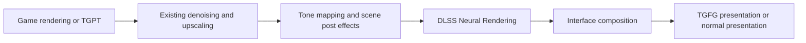

# TG Neural Rendering - high-level DLSS 5 specification

Status: researched design, 2026-10-07. Backend implementation and public release remain conditional on authorized
SDK/runtime access. This document is the handoff requested by the owner; it authorizes no claim that DLSS 5 already
works in TG Graphics Bridge. Working name: **TG Neural Rendering**, GUID `com.wessberg.tgneuralrendering`.

## Goal

Add optional NVIDIA DLSS 5 Neural Rendering to Tainted Grail: The Fall of Avalon using TG Graphics Bridge. Players
install one TG mod, enable a Video setting, and get the enhanced scene with unchanged interface text. RenoDX and
ReShade are not dependencies. The owner wants an independent NVIDIA SDK integration, with control over inputs,
placement and tuning. This is a separate visual enhancement; it does not replace Better Upscaling, Frame Generation
or Path Tracing, and must never be described as physically traced lighting.

## What the investigation confirms

| Question | Finding and evidence |
| --- | --- |
| Is direct NGX integration represented in NVIDIA code? | Yes. NVIDIA's [renderer adapter](https://github.com/nvpro-samples/vk_gltf_renderer/blob/master/src/dlss.cpp) probes, creates, evaluates and releases a separate NR feature through NGX. It supplies color, depth, motion, a control mask and reset information. This is Vulkan sample code, not a D3D12 implementation. |
| Does the sample require a special SDK? | Yes. Its [build configuration](https://github.com/nvpro-samples/vk_gltf_renderer/blob/master/CMakeLists.txt) checks for `nvsdk_ngx_helpers_dlssnr_vk.h`. It includes a local override example for `NVIDIA-NGX-DLSS-SDK-INTERNAL-v310.9.0-beta3`; this is an example path, not a public download or a required version. |
| Is that package publicly available through the reviewed download routes? | No public NR development-package download was established. The [DLSS release page](https://github.com/NVIDIA/DLSS/releases/tag/v310.9.1) still identifies 310.9.1 as latest. The [developer page](https://developer.nvidia.com/rtx/dlss) lists the conventional DLSS packages. The local 310.9.1 and Streamline 2.14.1 packages contain no NR helper header/runtime found by the targeted search. |
| Does a Streamline feature identifier suffice? | No. The local 2.14.1 header declares `kFeatureDLSS_NR = 1004`, but that does not supply a matching implementation or integration contract. [Public header](https://github.com/NVIDIA-RTX/Streamline/blob/v2.14.1/include/sl_core_types.h) |
| Is NR independent of SR, RR and FG? | NVIDIA describes it as an optional feature usable alongside those features, with game color and motion as inputs. Its currently announced launch hardware is RTX 50. Our availability decisions must still come from the authorized runtime. [NVIDIA announcement](https://www.nvidia.com/en-us/geforce/news/dlss-5-3d-guided-neural-rendering/) |
| Where does NVIDIA's example run it? | After tone mapping, before subsequent interface work, on a display-range image. The [renderer call site](https://github.com/nvpro-samples/vk_gltf_renderer/blob/master/src/renderer.cpp) excludes diagnostic/bypassed-tone-mapper paths. The [adapter declaration](https://github.com/nvpro-samples/vk_gltf_renderer/blob/master/src/dlss.hpp) documents LDR input and a clean denoised image. |
| Must we reuse RenoDX? | An independent implementation using authorized NVIDIA interfaces contains no RenoDX code and needs no RenoDX port license. No rights to its separate NR binary were established; this design does not use it. [RenoDX public-source license](https://github.com/clshortfuse/renodx/blob/main/LICENSE) |

Sources above were inspected on 2026-10-07. Moving-branch links are observations, not pinned build dependencies.
Before implementing the backend, record the exact SDK version, source revision, runtime hashes and applicable terms.

## Access and release requirements

The [public RTX SDK license](https://github.com/NVIDIA/DLSS/blob/main/LICENSE.txt) conditionally permits SDK use and
application distribution in object code, requires substantive application functionality and protective terms, and
restricts reverse engineering, circumvention and standalone SDK redistribution. The supplement adds NVIDIA-GPU,
credit/trademark and commercial-release notification conditions. Section 19 gives
`nvidia-rtx-license-questions@nvidia.com` for license questions. Beta-specific agreements may change what is allowed.

No supplied beta agreement or authorized NR runtime was available to review. Therefore **this inquiry cannot
confirm our eligibility, access or release permission**. A signed DLL, a game shipping DLSS 5, or a community mod
working is not evidence of our rights to ship that DLL. A download by the player's installer also needs an authorized
source and applicable permission. SDK evaluation permission must be distinguished from public-release permission.

The implementation handoff has these prerequisites:

| Required answer/material | Current state | Completion evidence |
| --- | --- | --- |
| Independent mod developer eligible for NR beta access | Unconfirmed | NVIDIA supplies access or an applicable public access policy. |
| Matching Windows x64 D3D12 headers, libraries, release runtime/model and integration guide | Not obtained | Authorized package with version, manifest and hashes; documented NR interface present. |
| Distribution with a free third-party game mod, including Nexus hosting/donation points | Unconfirmed | Applicable package agreement or NVIDIA clarification covers that use and the intended delivery method. |
| Application identity, notification, credit and branding requirements | NR-specific details unconfirmed | Record applicable requirements and the correct project/application registration. |
| D3D11-to-D3D12 resource sharing on the bridge device | Plausible, untested for NR | Matching SDK documentation plus a successful shared-device probe. |
| GPU, driver, OS, formats, motion/depth/mask conventions and supported SR/RR/FG combinations | Exact NR contract unconfirmed | Matching guide and runtime queries, followed by the tests below. |

The next agent may prepare managed rows, status plumbing and input validation while these are pending. It must not
substitute guessed feature numbers, parameter strings, another game's application ID, patched binaries or a leaked
package for the official NR backend. If authorized access is unavailable, leave the backend unavailable and report
that prerequisite; do not present the feature as implemented.

## Architecture

Target both game versions: Mono/BepInEx 5 and normal/BepInEx 6, on the existing D3D11 game renderer. TGPT combinations
apply to Mono only. Build a managed plugin and a native bridge extension using the existing bootstrap/election
layout in [AUTOLOAD-INTEGRATION.md](AUTOLOAD-INTEGRATION.md). The extension asks for `NeedD3D12`; Frame Generation
continues to own presentation when installed. Do not create another D3D12 device or another swapchain owner.

The bridge already supplies the devices, signed vendor-DLL loading and D3D11/D3D12 sharing. Its extension interface
is a lifecycle interface, not a shared post-processing scheduler. The implementation must provide explicit ordering
for the NR render event and color handoff. Independent custom-pass registration order is insufficient.

NGX initialization and DLL discovery must be coordinated with TGFG and TGBU. TGFG's current search-path addition is
conditional on TGBU plus TGPT; it does not register a new NR folder. Establish the authorized NR paths before the
first NGX initialization on the shared device. Keep per-feature handles separate, serialize access as the SDK
requires, and never shut down another mod's active NGX session when disabling NR. Resolve compatible DLL versions
as a documented set; preserve TGBU's settled rule for existing game-folder DLSS sets.

Useful implementation anchors:

| Existing code | Use |
| --- | --- |
| `native/bridge/include/tgb/bridge_api.hpp`, `d3d_interop.hpp` | Device ownership, signed loading and cross-API sharing/fences. |
| `native/framegen/src/sl_runtime.cpp` | First NGX initialization and plugin search paths. |
| `native/upscaling/src/rr_upscaler.cpp`, `dlss_dll.cpp` | Existing direct NGX behavior and DLSS-set preservation. |
| `src/TGFrameGeneration/HudlessUi.cs` | Existing AfterPostProcess color access; currently activated by FG, so it cannot be the new mod's only trigger. |
| `src/TGFrameGeneration/HdrpInputs.cs`, `src/TGBetterUpscaling/StpHost.cs` | Real HDRP guides and render-graph integration. Reuse suitable shared helpers without requiring those mods to be enabled. |
| `src/TGGraphicsBridge/MotionVectors.cs`, `VideoTab.cs`, `RowAlerts.cs` | Shared motion fixes, Video rows and row alerts. |

## Proposed render placement

This is the intended integration order; verify it against the delivered D3D12 guide and actual HDRP graph. Use one
NR evaluation per real gameplay frame. Apply it to the scene before interface composition, with color already at
the required display range/resolution. Never run it again on each generated frame.

HDRP's `AfterPostProcess` stage is a candidate, not proof that all conditions are satisfied: final-pass grain,
dithering, orientation, HDR conversion and UI ownership still require inspection. World-space labels and other
interface elements may already exist in scene color; identify them and preserve them through the documented mask
or composition mechanism. Menu text, subtitles and overlays must remain unchanged.

TGFG must capture its HUD-less scene **after** NR and receive the corresponding final color. Modifying color after
its scene capture would make it misidentify the changed scene as interface content. Validate this for DLSS, FSR and
XeSS FG. An NR-only installation must process the scene with FG and Better Upscaling absent.

## Input and lifetime contract

This table defines what our integration must establish. Concrete encodings come from the delivered guide, not
from the Vulkan sample or existing FG constants.

| Input/state | Required behavior |
| --- | --- |
| Color/output | Correct format, transfer function, exposure, gamut, extent and orientation. Distinct valid output until evaluation succeeds; preserve original scene on failure. |
| Motion | Actual game motion, including camera and moving objects. Record units, direction, scale, jitter convention and orientation; match color and frame ID. Never substitute zero motion to make a call succeed. |
| Depth | Match the same view/frame; declare hardware reversed depth or linear view depth accurately. Include viewport and near/far information when required. |
| Masks | Use only documented semantics, formats and resampling. Derive engine masks from real game data; distinguish them from the model's optional automatic mask. |
| Resolution | Record render/display sizes and every input subrectangle. Rebuild resources for resize and dynamic-resolution changes as required. |
| History | Reset on activation, camera cuts, loads, discontinuities and incompatible feature/model/size changes according to the SDK. Do not reset every normal frame. |
| Resource ownership | Keep Unity resources alive until their GPU reads/copies finish. Preserve render-graph dependencies and D3D11 state. |
| Synchronization | Producer and consumer fences have separate signalling owners. Prevent reuse before completion; bound error recovery without presenting an old or partially written frame. |

Support the game's SDR path first. HDR support is conditional on the documented NR color contract and a validated
conversion/composition path. Do not clip HDR into SDR and call HDR supported. If a color mode is unsupported, disable
NR for that mode with an explanatory row tooltip while the game's rendering continues.

For TGPT, feed the actual denoised scene and guides. Test RR and NRD independently; the sample's RR-only gate is not
evidence that every other denoiser is forbidden. Never hide RR because NR is installed. Do not feed NR output back
into tracer lighting, exposure, materials or denoiser history. Debug views should bypass NR.

## Settings and failure behavior

Keep one independent `DLSS Neural Rendering` Off/On row. Start Off for the first validation build. Final tuning and
default require the owner's in-game verdict. Keep SR quality and FG settings in their existing rows.

Provide controls for effect strength, model/style and detail/tone/skin adjustments only when the supplied SDK
documents them for the selected runtime. [NVIDIA's controls overview](https://www.nvidia.com/en-us/geforce/news/dlss-5-3d-guided-neural-rendering/)
confirms developer tuning and masking. Exact rows, values and ranges remain to be frozen after SDK receipt; do not
copy the sample's fixed style list as a capability table. Prefer plain player labels such as Strength, Detail and
Color, with tooltips explaining the specific documented effect. Avoid exposing developer mask-channel plumbing.

Video and FoA Mod Manager must show identical rows, choices, order, visibility and disabled reasons. Query the
runtime for availability; persist valid settings and clamp them when capabilities change. Unsupported hardware,
missing runtime, incompatible versions, unsupported color mode or failed evaluation disable NR alone. Show the
reason on its row with the established amber alert, retaining the user's saved preference where appropriate.

Log loaded paths/versions/hashes, actual NR availability, selected stage, input formats/sizes/color convention,
frame/reset IDs, accepted settings, evaluations/skips/errors and NR GPU cost. Availability is not proof that an
evaluation ran; a successful evaluation is not the owner's visual approval.

## Delivery and acceptance

1. **Access record:** resolve the prerequisite table; record package/license/version and D3D12 contracts. Keep
   proprietary SDK files outside tracked source. Establish public-source versus private-beta disclosure boundaries.
2. **Device probe:** on the actual bridge device, demonstrate feature discovery, creation, evaluation, resize and
   release with the authorized runtime; repeat with TGFG/Streamline and TGBU RR active. No image-quality claim yet.
3. **Scene pass:** NR runs once on a correctly matched gameplay frame, before UI and before TGFG scene capture.
   Test both game versions, camera cuts, loading, resolution changes and Off restoration.
4. **Compatibility and appearance:** test NR alone; Better Upscaling with DLSS/DLAA, FSR, XeSS and STP; FG Off and
   each supported FG backend; TGPT with RR and NRD on Mono; SDR and any declared HDR support. A combination may be
   withheld only for a documented contract conflict or reproduced failure with evidence.
5. **Player release:** owner approves the appearance and defaults, required checks pass, and permitted runtime
   delivery is integrated into normal Vortex packaging. Coordinate all mod versions and bump the bridge version
   for bridge changes. Ask before changing zip contents, as AGENTS.md requires.

Add meaningful tests for frame/viewport matching, resets, invalid resources and failure fallback; mutation-check
new correctness tests. GPU checks must establish that NR actually ran. Compare moving faces, hair, foliage, water,
dark interiors, bright skies and HUD/text, including pans and disocclusions. Confirm Off restores the unprocessed
scene and missing/unsupported NR leaves the other mods usable. Measure added GPU time, VRAM and real-frame FPS
with and without FG; generated FPS alone is not the performance verdict.

Run the game's tests only through `tools/harness/Run-PtHarness.ps1` and extend its captures as needed for NR.
Follow AGENTS.md's GPU gate, build/install/deploy/hash checks and testing rules. The current PT offline harness
does not exercise this NR path. No performance promise is made before measurement.

## NVIDIA inquiry draft - not sent

Recipient: `nvidia-rtx-license-questions@nvidia.com` (ask for routing to the DLSS NR SDK-access team).

Subject: DLSS 5 Neural Rendering SDK access and distribution for a free game mod

We maintain TG Better Upscaling and TG Frame Generation for Tainted Grail: The Fall of Avalon
(https://github.com/wessberg/TGFrameGeneration). We would like to add an independent DLSS 5 Neural Rendering
integration, without RenoDX or ReShade. The Unity 6000/HDRP 17 game renders D3D11; our existing bridge shares game
textures with one D3D12 device on the same NVIDIA adapter. The mod would run locally on Windows x64 and be
distributed free through Nexus Mods.

Could you confirm:

1. Whether an independent third-party mod developer can obtain the matching NR beta headers, D3D12 integration
   guide, libraries and authorized release runtime/model, and how to request access.
2. Whether evaluation and redistribution are permitted for this mod, including Nexus hosting and possible donation
   points; which files we may bundle, and what agreement, notices, credits, branding or notifications apply.
3. Whether D3D11/D3D12 shared resources and a shared NGX device/session alongside Streamline FG and direct NGX RR
   are supported, and what application/project registration we should use.
4. Which driver/OS/GPU, color/HDR, depth/motion/mask, history and feature-ordering contracts apply, including use
   with non-DLSS upscalers and denoisers.

We are requesting an authorized integration package and release terms. Please route this inquiry to the appropriate
SDK-access and licensing contacts.

## Handoff verdict

The independent design is plausible and the direct NGX approach is evidenced. **SDK access, the D3D12 contract and
NR runtime redistribution are not confirmed.** The next agent must resolve those prerequisites before implementing
the vendor backend or promising a distributable mod. This research changed documentation only; no SDK was acquired,
external inquiry sent, backend built or game tested.
